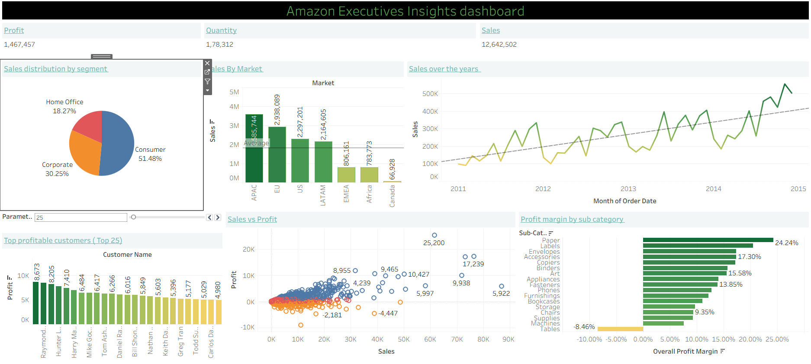

# Amazon Insights Dashboard (Tableau)

An interactive Tableau executive dashboard that analyses four years (2011-2014) of global retail sales: revenue, profit, quantity sold, market and segment mix, sub-category profitability and top customers. It is built on a 51,290-line orders dataset, and the dashboard figures were checked against the source data (see [Data validation](#data-validation)).

**[View the live dashboard on Tableau Public](https://public.tableau.com/app/profile/ayush.jain2433/viz/amazon_insights/AmazonExecutivesInsightsdashboard)**



> **Note:** The data comes from a Scaler assignment and is a sample retail dataset, not actual Amazon data. All monetary values are in US dollars (USD).

## Business Questions

The dashboard is designed to help an executive answer:

1. How big is the business, and is it profitable? (Sales, Profit and Quantity tiles)
2. How are sales trending over time?
3. Which markets and customer segments drive sales?
4. Which product sub-categories earn money, and which lose it?
5. Who are the most profitable customers?
6. Which products make a loss, a small profit or a high profit?

## Dashboard at a Glance

| View | What it shows | How it is calculated |
|---|---|---|
| Sales, Profit, Quantity tiles | Headline totals: $12.64M sales, $1.47M profit, 178,312 units | `SUM` of each measure |
| Sales over the years | Monthly sales with a trend line, 2011-2014 | `SUM(Sales)` by month of Order Date |
| Sales by market | Sales in each of the 7 markets, with an average line | `SUM(Sales)` by Market |
| Sales distribution by segment | Share of sales: Consumer, Corporate, Home Office | % of total `SUM(Sales)` |
| Profit margin by sub-category | Margin for each of the 17 sub-categories | `SUM(Profit) / SUM(Sales)` |
| Top profitable customers | Top N customers by profit (N set with a slider; the published view shows the top 25) | `SUM(Profit)` by Customer Name, top N filter driven by a parameter |
| Sales vs Profit | Each product as a point, coloured as loss / low profit / high profit | `SUM(Sales)` vs `SUM(Profit)` per Product Name, classified by the *Is Profitable* field |

**Interactivity:** a dashboard filter action is configured, so selecting a mark in a chart (for example a segment in the pie chart) filters the other views. The Top N slider controls the customer chart.

## Key Insights

All figures below were recomputed from the source data.

1. **Scale and profitability:** $12.64M in sales and $1.47M in profit (an overall margin of 11.6%) from 178,312 units across 25,035 orders.
2. **Strong, profitable growth:** sales grew 90% from $2.26M in 2011 to $4.30M in 2014 (year-on-year: +18.5%, +27.2%, +26.3%), while the margin stayed steady at 11-12%.
3. **Seasonality:** Q4 delivers 34.0% of sales (November and December alone 24.8%). The best month was November 2014 with $555,279 in sales.
4. **Market concentration:** APAC (28.4%) and EU (23.2%) together make up 51.6% of sales; the US adds 18.2%. EMEA has the weakest margin (5.4%) against 10-13% in the other large markets.
5. **Customer segments:** Consumer 51.48%, Corporate 30.25%, Home Office 18.27% of sales.
6. **Furniture drags on margin:** Furniture earns a 6.9% margin against 14.0% for Technology and 13.7% for Office Supplies. Tables is the only loss-making sub-category (-8.5% margin, -$64,083 profit on $757,042 sales).
7. **Discounts are closely linked to losses:** order lines with no discount never lose money, but lines discounted by more than 40% (6,961 lines) are loss-making 98% of the time and total -$627,411 in profit. Overall, 24.5% of order lines (12,544) lose money, adding up to -$920,646.
8. **Product mix:** of 3,788 products, 677 make a net loss, 2,666 earn up to $1,000 and only 445 earn more than $1,000.
9. **Diversified customer base:** the 10 most profitable customers contribute only 5.0% of total profit (the top 25: 10.6%).

### Questions this raises for leadership

- Should discounts above 20-30% be capped or reviewed, given how often they lead to losses?
- Is Tables (and Furniture generally) priced, sourced or discounted correctly?
- Why is EMEA's margin about half that of other markets?
- Is stock and staffing planned for the Q4 peak?

## Dataset

`data/Amazon_Data.xlsx` has three sheets. The dashboard uses **Orders** only.

| Sheet | Rows | Description |
|---|---|---|
| Orders | 51,290 | One row per order line, 24 columns |
| Returns | 1,173 | Returned orders (not used in the dashboard) |
| People | 13 | Regional managers (not used in the dashboard) |

- **Source:** sample dataset from a Scaler assignment
- **Period:** 2011-01-01 to 2014-12-31
- **Coverage:** 147 countries, 7 markets, 13 regions, 3 categories, 17 sub-categories, 3,788 product names, 1,590 customer IDs (795 unique customer names)

<details>
<summary>Key columns in the Orders sheet</summary>

| Column | Meaning |
|---|---|
| Order ID, Row ID | Order and order-line identifiers |
| Order Date, Ship Date | Dates of order and shipment |
| Ship Mode, Order Priority | Shipping method and priority |
| Customer ID, Customer Name, Segment | Customer and segment (Consumer, Corporate, Home Office) |
| City, State, Country, Postal Code | Delivery location |
| Market, Region | Geographic groupings |
| Category, Sub-Category, Product ID, Product Name | Product hierarchy |
| Sales, Quantity, Discount, Profit, Shipping Cost | Measures per order line |

</details>

## Calculated Fields and Parameters

| Name | Definition | Purpose |
|---|---|---|
| Overall Profit Margin | `SUM([Profit]) / SUM([Sales])` | Weighted margin used by the sub-category chart |
| Profit Margin | `[Profit] / [Sales]` | Row-level margin |
| Is Profitable | `IF SUM([Profit])<0 THEN 'loss' ELSEIF SUM([Profit])>=0 AND SUM([Profit])<=1000 THEN 'low profits' ELSE 'High Profit' END` | Colours products in the Sales vs Profit scatter |
| first customer order date | `{ FIXED [Customer ID] : MIN([Order Date]) }` | Level-of-detail (LOD) expression for first purchase date |
| Top N (parameter) | Integer slider, 1 to 800 | Controls how many customers appear in the customer chart |

## Data Validation

Before publishing, the workbook was checked against the source Excel file. Highlights:

- The data extract packaged inside the workbook matches the Excel Orders sheet: same 51,290 rows and identical values in 23 of 24 columns. The only difference is 16 Product Name cells with a trailing space in Excel, which Tableau trims; no chart is affected.
- The dashboard totals match totals recomputed from the data: Sales 12,642,501.91, Profit 1,467,457.29, Quantity 178,312. The segment shares match too.
- No duplicate rows, no negative or zero sales or quantities, and no shipment dated before its order. The only blank column is Postal Code, which is empty for non-US rows.

Full details are in [docs/DATA_VALIDATION.md](docs/DATA_VALIDATION.md).

## Limitations

- **Returns are not netted out.** 1,172 returned orders (4.7% of orders) account for 6.5% of sales and 8.0% of profit, so the figures are gross of returns.
- **Customer IDs vs names.** Each customer name appears under two IDs (one for APAC, EU, LATAM and US orders, one for Africa and EMEA orders). Counting IDs would double-count customers; the customer chart groups by name.
- **Historical sample data.** The data covers 2011-2014 only and is not real company data.
- **Data source path.** The workbook was created from a local file path. The extract is packaged inside the `.twbx`, so it opens anywhere, but refreshing from the source needs the data source re-pointed (see below).

## How to Open the Dashboard

**Online:** view the [published dashboard on Tableau Public](https://public.tableau.com/app/profile/ayush.jain2433/viz/amazon_insights/AmazonExecutivesInsightsdashboard).

**On your computer:**

1. Download `dashboard/amazon_insights.twbx`.
2. Open it in Tableau Desktop or the free [Tableau Public](https://public.tableau.com/) app (built with Tableau 2026.3).
3. The data is embedded, so no connection setup is needed. To refresh from the source file, go to **Data > Edit Data Source** and point it to `data/Amazon_Data.xlsx`.

## Repository Structure

```
amazon-insights-tableau-dashboard/
├── README.md
├── LICENSE
├── .gitignore
├── .gitattributes
├── dashboard/
│   └── amazon_insights.twbx      # Tableau packaged workbook
├── images/
│   └── dashboard.png             # dashboard screenshot
├── data/
│   └── Amazon_Data.xlsx          # source data (Orders, Returns, People)
└── docs/
    └── DATA_VALIDATION.md        # checks of the dashboard against the data
```

## Skills Demonstrated

Tableau dashboard design, KPI tiles, calculated fields, level-of-detail (LOD) expressions, parameters, dashboard actions, data validation, and turning data into business insights.

## Author

**Ayush Jain**

ECE graduate (B.Tech) building skills in data analysis, Python and Tableau.

GitHub: [ayushjain-real](https://github.com/ayushjain-real) | LinkedIn: [Ayush Jain](https://www.linkedin.com/in/ayush-jain-b02863416/)

## License

This project is licensed under the MIT License. See the [LICENSE](LICENSE) file for details.
